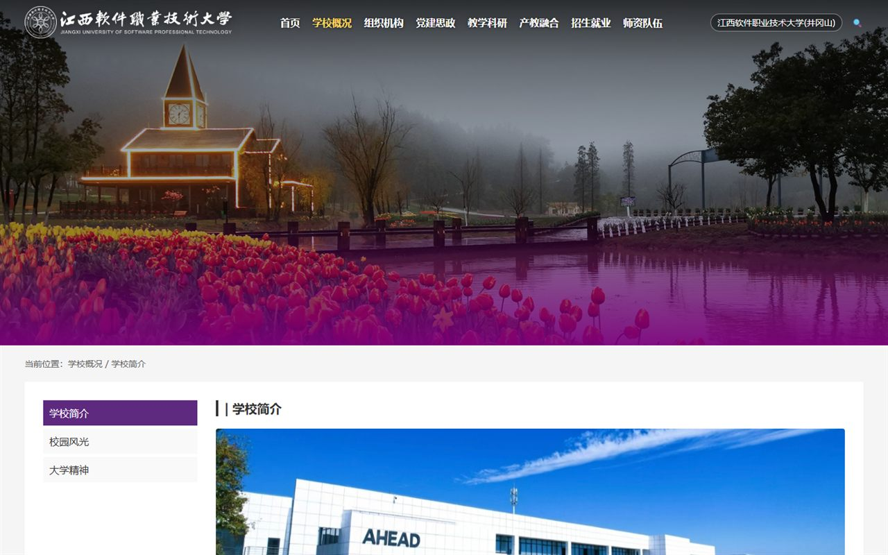

# 江西软件职业技术大学 · 官网前端

一个基于 **Vue 3 + Vite** 构建的高校官网前端项目，采用「通栏大图 + 透明导航」的视觉方案，覆盖首页、学校概况、组织机构等栏目，支持响应式布局，并通过 GitHub Actions 自动发布到 GitHub Pages。

[](https://github.com/wlb6666/university-website/actions/workflows/deploy.yml)




---

## 在线预览

**https://wlb6666.github.io/university-website/**

无需登录，任何设备打开即可访问。页面每次推送到 `master` 分支后约 1 分钟自动更新。

## 项目简介

项目将校园实景照片作为首页通栏横幅，导航栏以透明浮层的方式叠加在图片之上，左上角展示白色横版校标，形成「图片铺满顶部、信息叠加其上」的视觉结构。页面内容以结构化配置的方式维护，切换栏目时无需改动模板代码。

## 功能特性

- **通栏横幅**：首页横幅自页面顶端铺满，高度 560px（窄屏自适应），顶部叠加深色渐隐遮罩，保证白色校标与导航文字清晰可读
- **透明导航**：8 个一级栏目，其中「学校概况」「组织机构」「教学科研」「产教融合」「招生就业」「师资队伍」带二级下拉菜单，悬停展开
- **内容区布局**：面包屑 + 左侧栏目导航 + 右侧正文，切换栏目即时切换内容，无路由跳转
- **三种内容页形态**：图文简介（学校简介）、图片墙（校园风光）、条目列表（大学精神 / 理事会 / 监事会 / 党群结构）
- **响应式适配**：1280px / 1100px / 768px 三档断点，窄屏下导航自动换行居中，手机端校标缩小、栏目可横向滑动

## 技术栈

| 类别 | 选型 |
| --- | --- |
| 框架 | Vue 3.5（`<script setup>` 单文件组件） |
| 构建工具 | Vite 6 |
| 样式 | 原生 CSS（`src/style.css`），无 UI 组件库 |
| 部署 | GitHub Actions + GitHub Pages |

## 目录结构

```text
university-website/
├── .github/workflows/
│   └── deploy.yml          # GitHub Pages 自动构建部署工作流
├── docs/
│   └── preview.jpg         # README 预览图
├── images/
│   └── banner.jpg          # 首页横幅背景（被 src/style.css 以相对路径引用）
├── public/
│   └── images/             # 运行时图片资源，构建后原样复制到 dist/images
│       ├── logo.png        # 白色横版校标（校徽 + 书法校名 + 英文校名）
│       ├── ahead.jpg       # 学校简介配图
│       ├── FG1.jpg         # 校园风光一
│       ├── FG2.jpg         # 校园风光二
│       └── banner.jpg      # 旧横幅备份（当前未被引用）
├── src/
│   ├── App.vue             # 页面主体：导航配置、栏目内容、模板
│   ├── main.js             # 应用入口
│   └── style.css           # 全局样式与响应式规则
├── index.html              # HTML 模板（含站点标题与描述）
├── vite.config.js          # 构建配置（base: /university-website/）
├── package.json
└── .gitignore              # 忽略 node_modules、dist、日志
```

## 快速开始

需要 Node.js 18 及以上版本。

```bash
# 安装依赖
npm install

# 本地开发，默认 http://localhost:5173
npm run dev

# 构建生产版本，输出到 dist/
npm run build

# 本地预览构建产物
npm run preview
```

> 部署到 GitHub Pages 后，站点位于 `https://<用户名>.github.io/university-website/` 子路径下，因此 `vite.config.js` 中的 `base` 必须为 `/university-website/`。若仓库改名，需要同步修改该配置，否则静态资源会 404。

## 部署

仓库已配置 `.github/workflows/deploy.yml`，采用 GitHub Actions 构建后发布，无需手动上传构建产物。

1. 代码合并或推送到 `master` 分支
2. Actions 自动执行 `npm ci` → `npm run build` → 上传 `dist`
3. Pages 发布任务完成后，站点在该地址更新

首次在新仓库启用时，需在 **Settings → Pages → Build and deployment** 中将 Source 选为 **GitHub Actions**。

注意事项：

- GitHub Pages 对公开仓库免费；仓库若改为私有，站点会下线
- `dist/` 已被 `.gitignore` 排除，构建产物不进仓库
- 工作流运行记录见 [Actions 页面](https://github.com/wlb6666/university-website/actions)

## 内容维护

所有页面内容集中在 `src/App.vue`，分为配置区和模板区两部分，日常改内容只需动配置。

### 菜单配置

`src/App.vue` 中的 `navigation` 数组：

```js
{ label: '组织机构', category: '组织机构', children: ['理事会', '监事会', '党群结构'] }
```

- `label`：一级菜单显示文字
- `category`：与内容归属对应，用于高亮当前栏目
- `children`：二级菜单项，同时作为左侧栏的按钮列表

### 页面内容配置

`pageContents` 对象以**页面名**为键，与菜单项名称必须完全一致（含空格与全角符号），否则点击无效：

```js
理事会: {
  category: '组织机构',
  paragraphs: ['理事长：陈苏', '副理事长：饶勇', '理事：庄力可、范红铭、陈方平、周明华、熊虎'],
},
```

三种内容形态由字段决定：

| 形态 | 字段 | 渲染方式 |
| --- | --- | --- |
| 条目列表（默认） | `paragraphs` | 每条渲染为一段 |
| 图片墙 | `kind: 'gallery'` + `images` | 网格排列，`{ src, alt }` |
| 特制页面 | `kind: 'intro'` / `kind: 'spirit'` | 模板中单独实现，学校简介正文与「三好一专 十一工程」条目 |

> 新增栏目时需要同时修改 `navigation` 的 `children` 与 `pageContents` 的键名；`category` 建议一并填写，否则左侧栏目导航会错配到其他栏目。

### 图片引用规则

项目存在两套图片目录，用途不同：

| 图片 | 实际位置 | 引用方式 |
| --- | --- | --- |
| 校标 `logo.png` | `public/images/` | 模板中 `imageUrl('logo.png')` |
| 学校简介配图 `ahead.jpg` | `public/images/` | 模板中 `imageUrl('ahead.jpg')` |
| 校园风光 `FG1.jpg`、`FG2.jpg` | `public/images/` | `pageContents` 中 `imageUrl('FG*.jpg')` |
| 首页横幅 `banner.jpg` | 根目录 `images/` | `src/style.css` 中 `url('../images/banner.jpg')` |

- 运行时引用的图片一律通过 `imageUrl(文件名)` 拼接，该函数会自动带上 `BASE_URL` 前缀；**不要写死 `/images/xx.jpg`**，否则部署到子路径后必然 404
- 首页横幅走 CSS 背景图，随构建被打包进 `assets/`，因此它必须放在根目录 `images/`
- 替换图片时保持文件名不变即可，无需改代码；建议横幅宽度 1920px 以上

### 样式调整

- 顶部导航、横幅、内容区样式均在 `src/style.css`
- 导航为透明浮层（`.top-header` 绝对定位），文字为白色，因此**只能搭配白色版校标**与深色/图片背景使用
- 顶部遮罩由 `.banner-section::before` 的渐变控制，调高不透明度可提升文字对比度

## 已知限制

- 内容硬编码在 `App.vue`，没有后台管理或 CMS；栏目增多后建议将 `pageContents` 抽取为独立 JSON
- 部分栏目（党建思政、教学科研、产教融合、招生就业、师资队伍）尚未配置实质内容页
- 根目录 `images/` 内的 `ahead.jpg`、`logo.png` 与 `public/images/` 重复，属历史备份文件，可清理
- 导航切换为组件内状态，不改变浏览器地址栏，无法通过链接直达某个栏目页

## 声明

本项目为学习与演示用途的非官方站点，校名、校标、校园照片等素材版权归江西软件职业技术大学所有，未经授权请勿用于商业用途。
